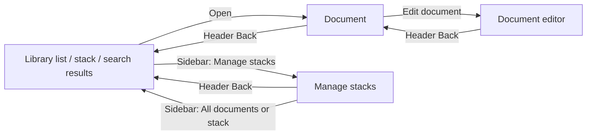

# Stack desktop interface and navigation review

## Current visual refinement against the browser mockup

This revision starts at `574bbec` and follows the user's explicit visual work order.
The HTML was read and opened in installed Chromium at **1080×860**, large enough
for its complete content. Native app captures use the same window size and six
independently authored readable PDFs, including a two-page water bill. Installed
COSMIC theme configuration was copied into the disposable review config root;
production uses the user's normal native theme. The source HTML remains unchanged.

| Area | Implemented refinement |
| --- | --- |
| Library | Stack navigation stays in the sidebar. Thumbnails render the first saved page through the existing saved-appearance renderer; compact names, real added dates and stack chips follow them. The cache is bounded to 50 results, with visible rows plus a margin decoded and laid out and more loaded on scroll. File icons are loading/error/unsupported fallbacks. |
| Surfaces | Sidebar uses native list buttons on a flat native theme surface, with no rounded inner navigation container. Tiles have one restrained thumbnail border and no outer white card. Text uses native foreground colors. |
| Viewer | A compact page/export toolbar replaces library search/Add. The page keeps its aspect ratio and zoom/pan, filling the practical center area. A 280px right information panel leaves more room for readable document text. |
| Editing | Information, Details and Pages stay in the right panel at wide sizes. Narrow information/editing layouts retain a preview above the scrolling controls. Existing explicit saves, recovery, draft retention and destructive confirmations remain. |
| Navigation/title | Back appears only with a destination. Header and window context read `Stack — All documents` or `Stack — <document name>`. Search/Add are hidden while a document is opening, viewed or edited. |
| Information | Labeled name/details/notes, compact membership chips, expandable stack choices, a notes field, and smaller edit controls. Values keep their exact stored representation and qualifiers. |

The original color/Unicode fixtures remain unchanged for their tests. Readable PDFs
are authored by `desktop/tools/prepare_ui_visual_review.py`; the capture route
checks their fixed hashes and exact library graph before displaying anything.
Native captures use the real app/event loop, compositor and renderer. Route changes
are injected application actions; they do not establish physical keyboard/chooser
or screen-reader acceptance. Earlier native platform qualifications remain.

Direct comparison and corrections: the first native run exposed a black transparent
background after removing the native content surface; the native surface was
restored. A transparent tile button style also erased label foregrounds; tiles now
use native list-item foregrounds. Intermittently absent sidebar labels led to using
native list buttons with the same navigation model/handlers and a clipped drawing
region. The final GPU captures show the complete sidebar in every state. The eager 50-thumbnail
prototype exceeded old debug layout/search targets; work is now limited to visible
rows while preserving the complete result page and scroll range. Intermediate
captures and check reports remain under `/tmp/stack-ui-refinement`.

Current native screenshots and the final check report are linked in M2 evidence
and results. Earlier sections below describe earlier revisions and proposal status;
this section takes precedence where their behavior differs.

Reviewed 2026-10-18, starting from `fd9dde7`. The user's concrete report was:
the first screen felt wordy; Manage stacks had no discoverable return; controls
moved between the top and left, obscuring which items were navigation.

The main finding is an inconsistent navigation model. Passing data-path tests did
not establish a coherent interface. This review traced current Rust handlers and
views, compared Stack's Android source, consulted the references below, and
inspected authored synthetic captures. New renders were made offscreen with the
actual COSMIC widgets; no native test window was opened on the user's desktop.
Older `/tmp/stack-m2-layouts-gpu` captures are historical, not current-build proof.

## Historical first mockup adaptation

The later user-provided `Mockup/stack-cosmic-desktop-mockup.html` supersedes the
speculative larger-layout recommendations below. Reference SHA-256:
`94874cc6e4c838ae8edf0062ca48ff8c8f44f4cd1100a01fdf2c4addc4f6c481`.
Its embedded app markup, styles and handlers were read locally. The supplied file
was preserved unchanged; its sample documents are a concept, not imported data.

The native revision follows its calm library sidebar, grid/list browser, large
preview, right-hand document information, and bottom backup control. COSMIC still
owns window chrome, themes, controls and adaptive navigation. Search/Add and header
Back remain fixed through navigation; Backup & restore now stays at the bottom of
the sidebar rather than in the earlier header Library menu. A collapsed sidebar
is reopened with COSMIC's existing navigation toggle.

| Area | Current native behavior |
| --- | --- |
| Library | All documents, ordered colored stacks and Manage stacks share one sidebar. Backup & restore groups archive import/export. |
| Browser | Grid/list controls, saved layout and sort, concise document cards/rows, bounded search snippets and 50-result pages. The cards use document icons; actual page thumbnails are not implemented. |
| Document | Preview and information appear together at wide sizes. Narrow sizes expose a Preview/Document information switch, retaining the selected document and draft. PDF export and page navigation stay above the workspace. |
| Information | Name, multiple memberships, exact saved details and notes are visible without entering the editor. Values are labelled saved, rather than claiming new extraction or confidence. |
| Editing | Information, Details and Pages sections replace the single long form. Explicit per-field saves, stale/failure recovery and source history remain. Unsaved changes are indicated and survive section/preview switches within the process. |
| Fidelity to the concept | Native controls replace web styling. No sample page is presented as an actual document thumbnail. No automatic-saving promise or separate star feature was inferred from in-memory HTML handlers. Existing Starred stack behavior is retained. |

This is a layout adaptation, not pixel-for-pixel implementation of every concept
feature. Remaining recommendations include bounded real page thumbnails, a visual
stack-color selector, safer switching of unfinished individual detail drafts, and
a quit/recovery policy for drafts. Drafts still do not survive process exit.
A separate Home route is not needed to match the supplied mockup: its rendered
sidebar begins at All documents, and its Home stack-card container is hidden by
its own handler. New OCR and sync remain separate milestones.

Headless pointer events now traverse the real grid/list buttons, edit sections,
Rotate page, and narrow preview switch before their messages execute the real
handlers/workers. The regression retains an unsaved exact title across these
changes and confirms the saved page rotation. Preference reopen checks preserve
sort and layout independently. Document deletion remains under Information, while
Pages contains page actions; page navigation stays in the workspace toolbar. Wrapped toolbar rows in the pinned toolkit omitted
child accessibility nodes in these tests; explicit rows/columns now expose the
new workspace controls. Native OS input and the existing AT-SPI qualification
still require the final user review.

The findings and first-correction contract below describe the preceding patch;
where their placement/proposal status differs, this mockup adaptation takes priority.

## Findings and disposition

| Priority | Finding and concrete effect | Disposition |
| --- | --- | --- |
| High | Manage stacks hid its return action inside its scrolling content, labelled “Documents”. Selecting a stack in the sidebar called `browse()` without clearing `catalog.open`, so the highlighted destination could change while the manager remained visible. | Fixed: persistent header Back, explicit Manage stacks destination, typed sidebar locations, sidebar selection closes management, and Ctrl+F leaves it. |
| High | Search, import and backup actions belonged to the library list's toolbar. Opening a document replaced that toolbar; editing replaced document controls again. Users had to remember which screen exposed each action. | Fixed: one persistent search/Add row, a fixed header Library action menu, and sidebar destinations. Page/content actions remain with their document. |
| High | A completed/canceled import used `browse()`, which also closed editors and cleared document selection. Background completion could take over navigation and obscure the user's unfinished work. | Fixed: background refresh updates saved lists without changing the active workspace or unrelated draft. Explicit Back/search/sidebar navigation controls route changes. |
| High | `select_matching()` cleared `selected` before the repository answered. The view could temporarily look like the document list rather than the loading destination. | Fixed: an opening-document state keeps the document route and Back visible during loading; superseded requests retain generation checks. |
| Medium | Return labels alternated between Documents, Back to documents and Preview, and the latter two appeared inside page content. | Fixed: header Back stays in the same place. From editing it returns to the document; from a document it returns to its prior list; from management it returns to that library context. |
| Medium | Saved confirmations were unqualified, while failed-save recovery and repeated saved values occupied normal editing space even when no failure existed. | Improved: Title saved/Notes saved/Stacks saved/Detail saved/Page saved identify the action. Recovery controls appear on failure; source history is explicitly expanded. |
| Medium | “On Home” described stack visibility despite there being no desktop Home screen. | Fixed for current architecture: Shown in sidebar/Show or hide in sidebar. A true Home view is a separate proposal below. |
| Medium | One long editor mixes title, notes, filing, detail entry, historical evidence, page tools and deletion. Important controls lie below a long scroll, and source evidence can be raw JSON. | Further design work: split document information, page tools and source history into clear sections. The initial patch reduces noise without redesigning metadata transactions. |
| Medium | Unsaved title/notes/filing changes have no persistent dirty indicator. Selecting another detail replaces its one in-memory detail draft; quitting drops unsaved drafts by the documented current contract. | Further work: explicit dirty state, safe handling when switching detail drafts, and a quit warning or recovery draft policy. A single Save changes must not be promised until its transaction/partial-failure semantics are implemented. |
| Medium | Document rows are plain title buttons. There is little visual structure or identifying context for similarly named documents. | Further design work: structured rows or cards with a bounded thumbnail/type marker and concise secondary information. Show a search snippet when useful. Keep the 50-row performance bound. |
| Medium | The stack editor exposes hex RGB codes, and standard category accents can override an edited saved color. A Save color action can appear ineffective for those categories. | Further work: a small visual palette with an advanced custom input; make fixed category colors or any allowed override explicit and consistent with Android's display rules. |

Relevant implementation: [navigation](../../desktop/crates/stack-desktop/src/navigation.rs),
[application views and routing](../../desktop/crates/stack-desktop/src/main.rs),
[stack manager](../../desktop/crates/stack-desktop/src/catalog.rs),
[document editing](../../desktop/crates/stack-desktop/src/editor.rs),
[transfer completion](../../desktop/crates/stack-desktop/src/transfers_ui.rs).
The pre-change findings refer to the named functions at `fd9dde7`; the links show
the corrected working source rather than preserving obsolete line numbers.

## Navigation contract implemented by the first correction

The sidebar answers “Where am I?”: All documents, individual stacks, Manage stacks.
The header Library menu answers “What can I do to the library?”: import backup,
export backup, refresh. The search/Add row stays present across those locations.
Current-location headings and scoped search text explain the active stack. Library
actions retain their location in the header when the central content changes.

Back restores query, stack filter, result page and recorded list scroll rather
than changing the meaning of navigation into Refresh. Escape cancels an open
Library menu first and retains the existing editor-confirmation behavior. The
wide search row reserves a Clear control so typing doesn't move Add to another
row; narrow windows use labelled icon controls. The sidebar collapses according
to available width, not according to which content screen is open.

Importing a backup remains additive, with explicit review. PDF output remains a
document action. Moving those actions into a menu changes placement and wording;
it does not add sync or change archive/save/delete semantics.

## Direction for the larger interface revision

Stack Android is the primary product reference. Its
[main screen](../../app/src/main/java/org/stackdocs/app/MainActivity.java) has
Home/All documents, Your Stacks, Recent documents and one Add action. Its
[document view](../../app/src/main/java/org/stackdocs/app/DocumentActivity.java)
keeps Back and document actions in a toolbar, prioritizes preview, and provides a
Details/Read distinction. These are source observations; no phone was opened or
modified, and preexisting Android edits were preserved.

A coherent desktop evolution would give Home a compact Your stacks/Recent
documents view, retain All documents, and keep the same sidebar and header in
every workspace. A document workspace would group Preview, Details and Pages,
with source history expanded on request. At wide sizes, details can sit beside
the preview; narrow layouts can show one section at a time. Returning to the list
should preserve its position. Ordinary actions need clear names and a small visual
hierarchy; diagnostics, backup tools and destructive actions should appear when
relevant to the task.

Keep Stack's existing model: documents may belong to several stacks. A displayed
return path represents how the user arrived, not a new mandatory folder hierarchy.
Original retention, stable page identity, exact amounts, provenance and journaled
decisions remain unchanged.

## What the references contribute

[BookStack's navigation guide](https://www.bookstackapp.com/docs/user/getting-around/)
describes persistent book context in a sidebar, breadcrumbs, adjacent-content links
and header search. Those mechanisms explain where a user is and how to return.
For Stack, the useful adaptation is stable context and predictable navigation;
its book/chapter/page hierarchy does not need to become Stack's data model.

[Paperless-ngx's usage guide](https://docs.paperless-ngx.com/usage/) is closer to
Stack's document domain: a searchable/filterable document list leads to a document
workspace containing preview and metadata. It supports grouping document tasks in
one recognizable place. Its many management capabilities are not requirements to
add to this companion app.

The [GNOME sidebar guidance](https://developer.gnome.org/hig/patterns/nav/sidebars.html)
describes sidebars as locations and places controls affecting that list above it.
That reinforces a distinction between destinations and actions. This is design
guidance; the implementation remains native COSMIC.

## Verification and limits

The new headless navigation regression follows the reported first screen → Manage
stacks → Back path. It checks saved context, actual sidebar navigation out of
management, header/search action bounds across library/manager/document/editor,
Back during loading, and preservation of an unsaved title through a real completed
import. It also checks that Escape closes the Library menu before navigating.
Authored offscreen renders are in `/tmp/stack-ui-navigation-review`.

These captures verify layout and recorded rendering without opening a window;
they do not establish native focus, live compositor behavior or screen-reader
support. The pinned AT-SPI/platform qualifications remain in the M2 evidence. The
full headless closeout report and any remaining failures are recorded alongside
the current M2 results; earlier 43-test evidence is historical after these changes.

User visual review remains the final step. The authoritative checkbox is still in
the [project plan](../STACK_DESKTOP_PLAN.md#one-consolidated-user-dependent-checklist-for-implementation-closeout);
the [review route](M2_REVIEW.md) now begins with the exact Manage stacks return
journey reported here. The wider editor/list/color/draft recommendations above are
not represented as implemented by the first navigation correction.
